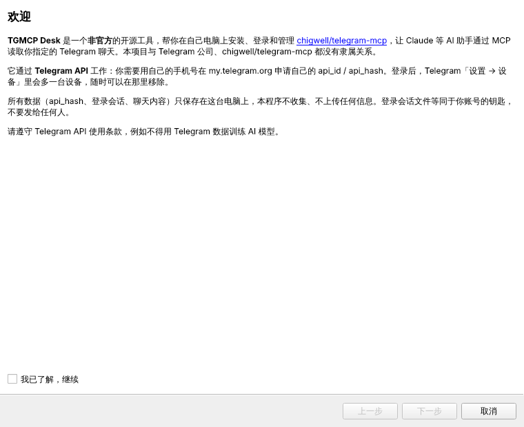
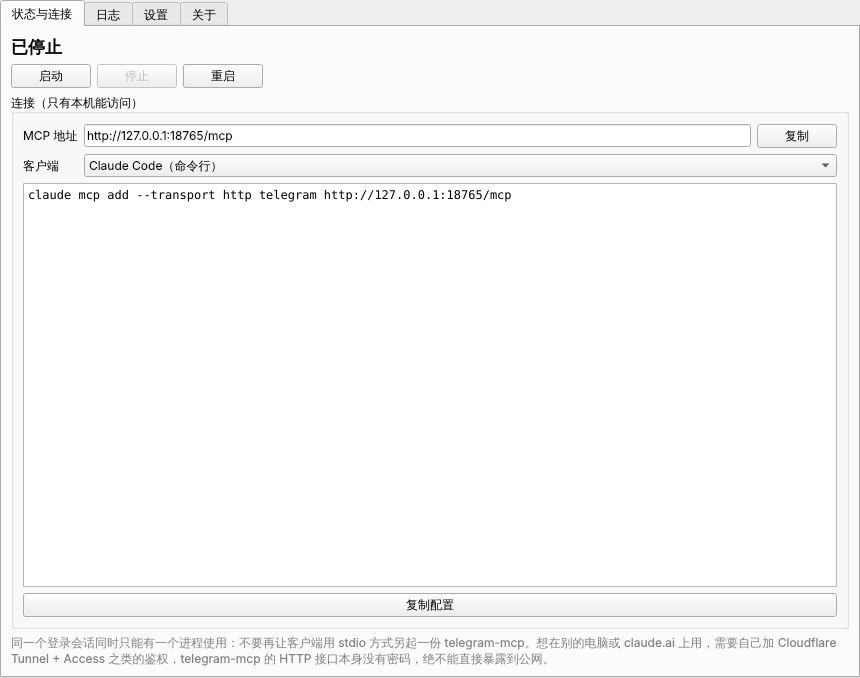
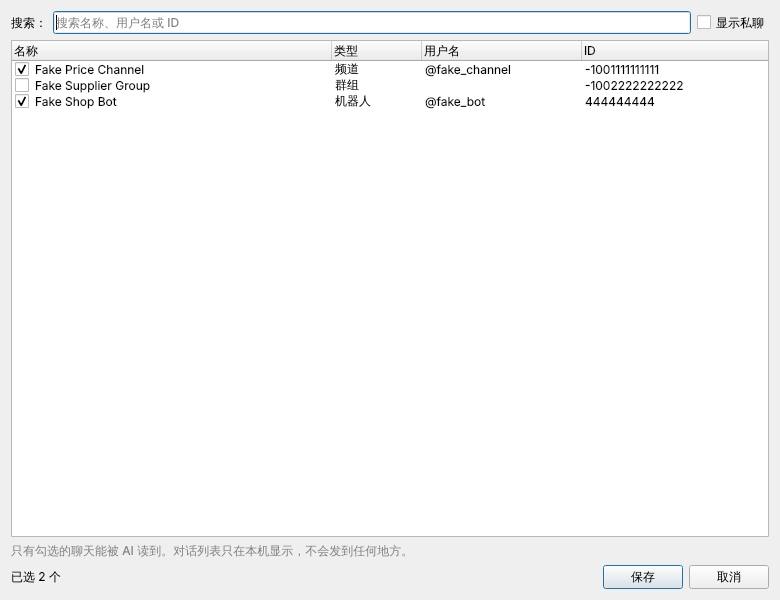
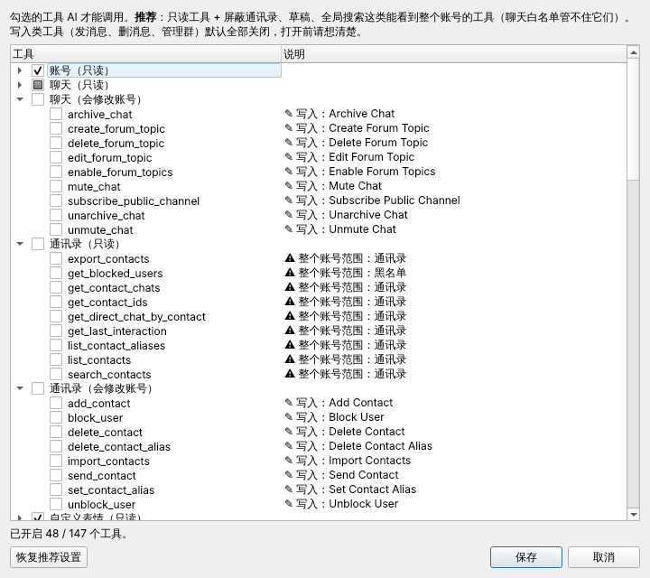

# TGMCP Desk

**非官方** · [chigwell/telegram-mcp](https://github.com/chigwell/telegram-mcp) 的 Windows 桌面管理器

[English summary below](#english)

把 telegram-mcp 的安装、Telegram 登录、聊天白名单、工具权限、启动停止和日志，做成一个带图形界面的桌面程序：第一次打开是设置向导，之后常驻在任务栏右下角。适合想让 Claude、Cursor 等 AI 助手读取**自己指定的** Telegram 频道和群、但不想敲命令行的人。

> 本项目与 Telegram 公司、chigwell/telegram-mcp 都没有隶属关系。它通过 Telegram API 工作，每个用户都需要用自己的 api_id / api_hash。

| 设置向导 | 状态与连接 |
| --- | --- |
|  |  |

| 选择频道 | 工具权限 |
| --- | --- |
|  |  |

（截图里的聊天都是编造的示例数据。）

## 能做什么

- **一步步装好**：自动下载 uv 和固定版本的 telegram-mcp（只从 GitHub 下载，不用 PyPI 上那个同名但无关的包），准备好 Python 环境。已经手工装过的，选原来的文件夹就能直接用。
- **填 api_id / api_hash**：带 my.telegram.org 的引导和格式检查。
- **代理**：自动查找本机 Clash / v2rayN 端口，一键测试能否连到 Telegram。
- **窗口里登录**：手机号 → 验证码 → 两步验证密码，登录也走代理，不需要扫码，也不需要打开 TUN 模式。生成本地会话文件，不把会话字符串写进配置。
- **聊天白名单**：列出你的频道、群和机器人，勾选哪些允许 AI 读（私聊默认隐藏，不能一个都不选）。
- **工具权限**：默认只读，并屏蔽通讯录、草稿、聊天文件夹、全局搜索等能看到整个账号的工具（白名单管不住它们）。工具清单从你安装的 telegram-mcp 源码里实时读出，不会写出让服务启动失败的配置。
- **托盘常驻**：启动 / 停止 / 重启，三色状态图标，意外退出 30 秒后自动重启（连续 5 次刚启动就退出会停下并提示），内置日志窗口，日志超过 20 MB 自动轮转。
- **端口**：自动避开 Windows 保留端口段（telegram-mcp 默认的 8765 常被 Hyper-V / WSL 占用）。
- **连接配置**：一键复制 Claude Code、Cursor、VS Code、Claude Desktop 的 MCP 配置。
- **诊断包**：导出去掉 api_hash、会话、手机号、聊天 ID 和用户名的日志与配置，方便提 issue。

## 下载和使用

1. 到 [Releases](../../releases) 下载 `TGMCP-Desk-<版本>-windows-x64.zip`，解压后运行 `TGMCP Desk.exe`。
   程序没有代码签名，Windows 可能提示「已保护你的电脑」，点「更多信息 → 仍要运行」。
2. 按向导走：安装 → 填 api_id / api_hash → 代理 → 登录 → 选择聊天和工具权限 → 完成。
3. 在「状态与连接」里复制你所用客户端的配置。

从源码运行（需要 [uv](https://docs.astral.sh/uv/)）：

```bash
uv sync
uv run tgmcp-desk
```

## 安全说明

- 所有数据只在你的电脑上：api_hash 和代理设置在 telegram-mcp 安装目录的 `.env`，登录会话在同一目录的 `.session` 文件。本程序不联网收集任何信息，只访问 GitHub（下载）和 Telegram（经你的代理）。
- `.session` 文件等同于你账号的钥匙，不要发给任何人。随时可以在手机 Telegram「设置 → 设备」里移除这台设备。
- telegram-mcp 只监听 `127.0.0.1`。它的 HTTP 接口**没有密码**，想从别的设备访问时必须自己加鉴权（例如 Cloudflare Tunnel + Access），绝不能直接暴露到公网。
- 「只读」只限制 AI 能调用的工具，不降低进程内 Telegram 会话本身的权限。
- 请遵守 [Telegram API 使用条款](https://core.telegram.org/api/terms)，例如不得用从 Telegram 获取的数据训练 AI 模型。

漏洞请按 [SECURITY.md](SECURITY.md) 私下报告。

## 状态

v0.1 开发中。核心逻辑和界面有自动测试（Linux / Windows CI，界面用无头模式），但**完整流程还没有在真实 Windows 和真实 Telegram 账号上验收**，第一个正式版发布前会补上。

测试过的 telegram-mcp 版本：v3.2.98。

## 开发

```bash
uv sync
uv run pytest            # Linux 需要 libegl1 等 Qt 依赖；无头运行设 QT_QPA_PLATFORM=offscreen
uv run ruff check . && uv run ruff format --check .
uv run python tools/check_no_secrets.py
```

结构：

- `src/tgmcp_desk/core/`：纯逻辑（.env 编辑、工具权限、白名单、端口、代理测试、安装、重启策略、脱敏），不依赖 Qt。
- `src/tgmcp_desk/helpers/`：在 telegram-mcp 自己的 Python 环境里运行的小脚本（登录、读对话列表），通过标准输入输出逐行 JSON 和界面通信。本程序本身不包含 Telegram 协议代码。
- `src/tgmcp_desk/ui/`：PySide6 界面。
- `tests/fakes/`：测试用的假 Telethon，所有数据都是编造的。

打包：`uv sync --group build && uv run python packaging/make_icon.py && uv run pyinstaller packaging/tgmcp-desk.spec`。推送 `v*` 标签，或在 Actions 里手动运行 Release 工作流并填版本号，都会构建 exe 并创建草稿 Release。

## 许可证

[Apache-2.0](LICENSE)。本项目不包含 chigwell/telegram-mcp 的代码，安装时由你的电脑从 GitHub 下载上游（同为 Apache-2.0）。

---

## English

**TGMCP Desk** is an *unofficial* Windows desktop manager for [chigwell/telegram-mcp](https://github.com/chigwell/telegram-mcp). A setup wizard downloads uv and a pinned upstream release from GitHub, collects your own `api_id` / `api_hash`, configures and tests a proxy, logs in with phone + code (+ 2FA) through that proxy, and lets you pick a chat allowlist and a tool exposure policy (read-only with account-wide tools such as contacts hidden by default). Afterwards it lives in the system tray: start/stop/restart with auto-restart, a log viewer, MCP client config snippets and a redacted diagnostics export.

Everything stays on your machine; the app collects nothing. Not affiliated with Telegram or with chigwell/telegram-mcp; it uses the Telegram API and each user needs their own API credentials. The UI is Chinese-only for now. Licensed under Apache-2.0.
